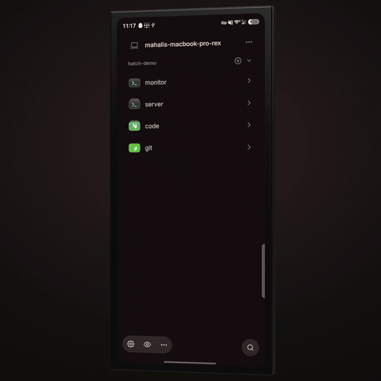

<p align="center">
  
</p>

<h1 align="center">Hatch</h1>

<p align="center">
  An experimental, unofficial Android client for <a href="https://rex.superlogical.com">Rex</a>.<br>
  Rex has no Android app yet, so I made one.
</p>

<p align="center">
  
</p>

It works like the other Rex clients. Pair it with your server, then use your sessions, tabs and terminals from a phone, a fold or a tablet. The terminal is [libghostty-vt](https://github.com/ghostty-org/ghostty).

**[Download the APK](https://github.com/mahali00/hatch/releases/latest)** for ARM phones, folds and tablets on Android 8.0 or newer. It is an experiment, shared as is, and it may break as Rex changes.

Rex does not authenticate connections, so keep your server on a network you trust or behind a tunnel such as Tailscale.

## Build

You need the Android SDK (platform 37), NDK 28.2.13676358, CMake 3.22.1 or newer, Zig 0.17.0, and an ARM device on Android 8.0 or newer. The first command clones Ghostty into the folder you name and builds the terminal library.

```sh
scripts/build-ghostty.sh /path/to/ghostty-checkout
./gradlew :app:installDebug
```

## License

[MIT](LICENSE). libghostty-vt, the bundled fonts and the program logos keep their own licenses and owners. See [design/ICONS.md](design/ICONS.md) and [design/src/main/assets/licenses](design/src/main/assets/licenses).
